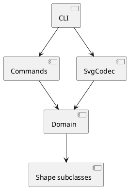

# 架构方案

## 模块划分

- `src/domain`：`DocumentModel` 管理唯一 id 索引和根容器；`Shape` 及其多态子类封装几何、移动、缩放和 SVG 序列化；`ShapeFactory` 是类型名到类的唯一工厂分派点。
- `src/commands`：Command 接口、History，以及 `MutationCommand`。每条编辑命令保存前后文档快照，因此一个命令对应一个 undo 单元，失败会回滚。
- `src/io`：`SvgCodec` 负责 SVG XML 读写、缺失 id 自动分配和警告。
- `src/cli.ts`：REPL、参数 tokenization、命令名到处理逻辑的分派、统一错误输出。

## 设计模式的选择

实现了 Command 模式：编辑操作以 `MutationCommand` 封装，`History` 只依赖 `Command` 接口维护 undo/redo 栈。Composite 由 `GroupShape` 与所有叶子共享 `Shape` 抽象实现，容器和叶子都能 move、scale、delete、set。工厂分派暂时集中在 `ShapeFactory`，命令名分派暂时集中在 CLI，二者是规格允许的两个待重构点。

## 依赖方向规则

`cli -> commands/io/domain`；`commands -> domain`；`io -> domain`；`domain` 不依赖 CLI、命令或文件系统。具体图形类只依赖 `Shape`。这样领域模型可独立测试，IO 和交互层可替换。

## 变化点假设

1. 新图形类型最可能增加：保留 `Shape` 多态接口和 `ShapeFactory` 插槽，后续可改为注册表/插件。
2. CLI 语法可能扩展：tokenizer 与命令分派集中在 CLI，便于替换为命令注册表。
3. SVG 属性与 XML 方言可能扩展：序列化集中在图形类，文件解析集中在 `SvgCodec`。
4. 复杂编辑的性能可能变化：当前快照方案清晰可靠，Phase 1 不为大型文档提前引入增量补偿。

# 过程记录

先按规格拆出领域模型、IO、命令和 CLI 四层；实现运行时发现 Node 的 type stripping 不支持参数属性，改用 Node 24 的 `--experimental-transform-types`，并把类型导入改为 `import type`。随后用题目给出的典型会话回放，修正了可选 fill/stroke、树形缩进和 IO 后禁止 undo 的行为。

# 一致性自查

实际目录与方案一致：`domain`、`commands`、`io` 和 CLI 均已建立。依赖方向抽样符合规则：文件系统只出现在 `cli.ts`，`SvgCodec` 接收字符串并返回领域对象；领域类没有导入 CLI 或命令模块。

# 质量保证手段

使用 Node 24 `--experimental-transform-types` 运行 CLI，回放 init/create/group/tree/move/undo/redo/set/delete/save 场景；另有 smoke test 覆盖嵌套容器、SVG round-trip、缺失 id 警告、错误回滚和 undo/redo。提交前执行 `git diff --check`。
